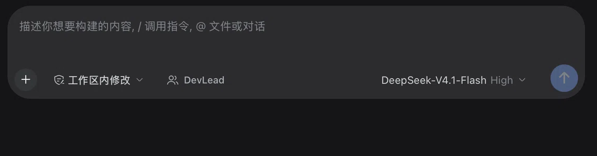
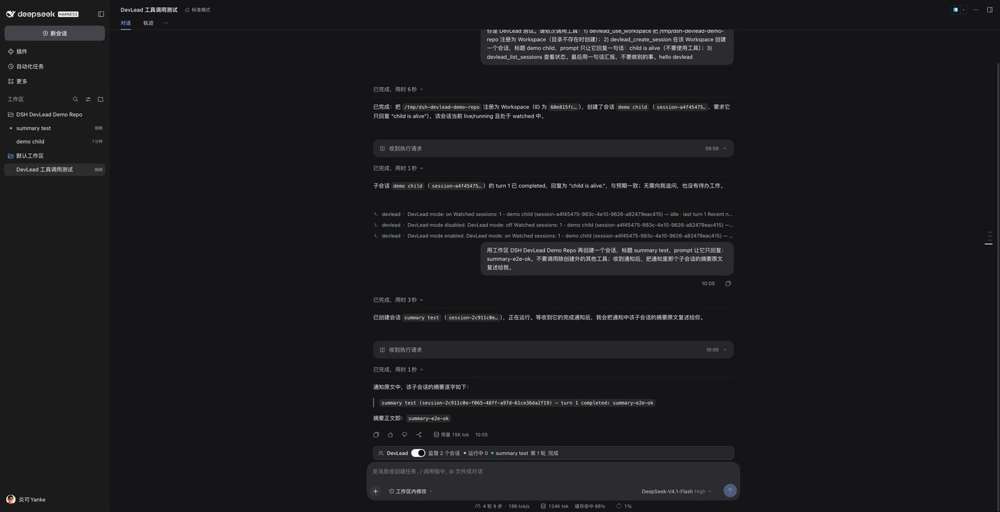

# dsh-devlead

[English](https://github.com/yankeguo/dsh-devlead/blob/main/README.md) · **简体中文**

一套面向 [DeepSeek Harness](https://github.com/deepseek-ai/deepseek-harness)（DSH）的插件套件：
把**一个普通会话**升级成 **DevLead 会话**。它可以直接操作 DSH 的 **Workspace**（工作区）与
**Session**（会话），创建并续写其他会话、读取它们的状态、在状态变化时被唤醒——于是一个
agent 就能在人可见、可参与的标准界面里统管多个仓库。

稳定版 **0.4.1** · DSH **0.2.2-rc.1 – 0.2.2-rc.5** · 一条 `dsh plugin` 命令即可装好全部组件。

## 核心能力

| 能力 | 对你意味着什么 |
| --- | --- |
| **每个会话一个持久开关** | `/devlead on` 把当前会话变成 DevLead。开关是**人类专属**的，且 Host 全局唯一：最多一个会话能持有它，重启后依然有效，直到人类关闭。 |
| **调度者，而非实现者** | DevLead 依据已注册的元数据判定请求归哪个 Workspace，向那里的 Session 发送一份自包含简报，关注它、审阅交付并汇报。更深的调查与实现留在子会话里。 |
| **真实的 DSH 实体** | Workspace 走 `ctx.workspaceRegistry`；子会话是侧边栏里可见的普通 Session，你可以打开、继续、归档——不是隐藏的 subagent。 |
| **通知回路** | 被关注 Session 的 turn 结束时，一条持久通知会唤醒 DevLead，让它跟进、派发新工作或汇报。重启后关注索引会从持久记录重建。 |
| **16 个主工具 + 1 个汇报工具** | 注册/列出/移除 Workspace，列出 Host 模型与 Agent preset，创建/读取/续写/归档/恢复/关注 Session，查看并撤回排队的 inbox 输入，读取通知与汇报摘要，并维护可选的用户可见项目看板。被关注的子会话另有单向的 `devlead_report`。 |
| **人类命令** | `/devlead`、`/devlead on\|off`、`/devlead reset`、`/devlead watch\|unwatch <session>`——会话可用完整 id 或唯一前缀寻址。 |
| **可选的 worktree 隔离** | 当 Host 组合了 DSH 的实验性 Git worktree 服务时，被派发的 Session 可以拥有自己的分支和检出，而不必共享 Workspace checkout。缺少该能力时退化为共享 checkout，并在结果里如实上报状态。 |
| **Web 界面** | composer 工具条里的带文本 DevLead 开关（两态都在）、开启后的只读 DevLeadBar、侧边栏 active/watched 标记，以及可选的右侧栏只读项目看板。 |

## 与 subagent / agent-team 的对比

| 维度 | subagent / agent-team | DevLead |
| --- | --- | --- |
| 工作产物的身份 | 派发方内部的子 agent，通常不是可独立打开的普通会话 | 真正注册的 Workspace + 普通 Session，侧边栏可见，人类可打开/继续/归档 |
| 人类可见性 | 人类通常只看到最终汇总 | 人类能看到一切，并可随时接管任意子会话 |
| 交互模型 | 模型在单个 turn 内派发并等待 | DevLead 会话本身就是普通会话；模型用 `devlead_*` 跨 turn 编排——派发、结束本轮，由 settle 唤醒开启新 turn——人类可以在同一界面里加入 |
| 生命周期 | 随父 turn / 父 agent 结束 | 子会话独立存在且可续写；`turn/end` 通知持久，可跨重启 |
| 开关 | 无 | **人类专属** `/devlead on\|off` 或 composer 工具条开关；模型没有任何工具能开启它 |
| 适用场景 | 一次性并行子任务 | 跨仓库、长周期，需要人类持续参与和审阅的编排 |

经验法则：一次性并行子任务用 subagent / agent-team；当 agent 需要长期负责多个仓库、
且人类希望看到并随时接管每个子会话时，用 DevLead。

## 环境要求

| 项 | 要求 |
| --- | --- |
| DSH | **0.2.2-rc.1 – 0.2.2-rc.5**（插件与 bundle 包声明 `engines.dsh: >=0.2.2-rc.1 <0.3.0`；DSH 加载器会跳过范围不匹配的 bundle） |
| UI 平台 | DSH 桌面端或 `dsh web`；DevLead 界面只在 **Web** 平台渲染 |
| 实验性 bundle | 无需任何实验性 bundle。DevLead 面向默认 Web 组合（`dsh-base` + `dsh-web-app`）构建 |
| Agent Teams（可选） | 派发时使用 `agent_teams: true` 需要 DSH 0.2.2-rc.2+，且 Host 组合了 `agent-team` |
| Worktree 隔离（可选） | 需要 profile 中组合了 DSH 实验性 worktree 服务；默认关闭 |
| Node.js / pnpm | 仅从源码构建时需要——见 [docs/CONTRIBUTING.md](https://github.com/yankeguo/dsh-devlead/blob/main/docs/CONTRIBUTING.md) |

完整兼容矩阵（逐 DSH 版本，含上游 API 注意事项与升级门禁）见
[docs/COMPATIBILITY.md](https://github.com/yankeguo/dsh-devlead/blob/main/docs/COMPATIBILITY.md)。

## 安装

### 从 npm 安装（推荐）

```sh
dsh plugin --profile desktop add @yankeguo/dsh-devlead-bundle
```

这会安装主 bundle：核心 Host 服务、模型工具、`/devlead` 命令以及浏览器 UI。也可以在 Web 界面
通过 **Plugins → Add plugin** 输入 `@yankeguo/dsh-devlead-bundle` 安装。安装完成后，到
**Plugins** 页面确认 bundle 已启用（新装的 bundle 通常默认启用；没有的话勾选一下），然后刷新
Web 页面。

固定到精确版本：

```sh
dsh plugin --profile desktop add @yankeguo/dsh-devlead-bundle@0.4.1
```

0.4.1 是无公网 API 变更的补丁版：物理完好的当前 v4 日志仅因包含当前 Harness 不认识的无关旧事件
而被 Host 拒绝时，DevLead 现在可以有界、只读地恢复 supervisor 扫描。从 0.4.0 升级无需为此清理
日志或执行 `/devlead reset`。详见
[0.4.1 release notes](https://github.com/yankeguo/dsh-devlead/blob/main/docs/releases/v0.4.1.md)。

进阶用户可以单独安装各个包，并自行把对应的 loader row 插入 profile 的 `cordis.patch.yml`；
推荐直接用 bundle。

### 升级

```sh
# 把 bundle 升级到最新发布版
dsh plugin --profile desktop add @yankeguo/dsh-devlead-bundle

# 或固定到某个版本
dsh plugin --profile desktop add @yankeguo/dsh-devlead-bundle@0.4.1
```

> **从旧版本（低于 0.4.0）升级：** 0.4.0 会直接丢弃旧的 DevLead 会话状态（模式、关注集合、
> 通知 digest、answer 状态），而不是迁移。升级后请打开每个受影响的 DevLead 会话，先执行人类
> 专属的 `/devlead reset`，再重新 `/devlead on`。完整升级说明见
> [0.4.0 release notes](https://github.com/yankeguo/dsh-devlead/blob/main/docs/releases/v0.4.0.md)
> 与 [docs/COMPATIBILITY.md](https://github.com/yankeguo/dsh-devlead/blob/main/docs/COMPATIBILITY.md)。

### 卸载

```sh
dsh plugin --profile desktop remove @yankeguo/dsh-devlead-bundle
```

DSH 下次加载 profile 时会清理已移除 bundle 的选择。

发布历史与各版本说明见 [GitHub Releases](https://github.com/yankeguo/dsh-devlead/releases) 与
[docs/releases/](https://github.com/yankeguo/dsh-devlead/tree/main/docs/releases)。

## 快速开始

1. 在准备统管多个仓库的那个会话里执行 `/devlead on`（或点 composer 工具条上的 DevLead
   按钮）。每个 Host 只能有一个 Session 持有该模式。
2. 用自然语言提需求。DevLead 判定请求归哪个已注册的 Workspace，必要时注册仓库
   （`devlead_use_workspace` 接收绝对路径；除非明确要求，绝不创建缺失目录），归属不清时
   先问，而不是猜。
3. DevLead 把一份**自包含简报**派发给归属 Workspace 里的子会话：背景、目标结果、需要子会话
   确认或细化的开放问题、交付物、如何验证，以及哪些不要动。子会话看不到 lead 的对话，所以
   所有必要事实都要在简报里重述。
4. 子会话独立运行。你可以随时从侧边栏打开它、继续对话或接管。DevLead 不会原地等待，而是
   结束本轮。
5. 子会话的 turn 结束（completed / failed / blocked / cancelled / …）时，DevLead 会被一条
   持久通知唤醒。它检查状态、跟进，或向你汇报。
6. DevLead 汇报它创建、改动或关闭了哪些 Workspace 与 Session，每个子会话被要求做什么，
   最近一轮如何结束，以及哪些事需要人类决策。

一段可以直接粘给 DevLead 会话的请求：

```text
为这个会话打开 DevLead 模式。把 /Users/me/Workspace/src/api 和
/Users/me/Workspace/src/webapp 注册为工作区，各开一个子会话——第一个修 CI 失败，
第二个补上缺失的 README。两个都完成后汇总；失败的要继续跟进，不要谎称成功。
```

## 使用 DevLead 会话

### 打开与关闭模式

模式开关是**人类专属**的：在任意会话里执行命令，或点 composer 工具条上的 DevLead 按钮。
对 top-level Session 来说，按钮在两种状态下都存在：模式关闭时发送 `/devlead on`，开启时发送
`/devlead off`。subagent Session 永远不显示该按钮（也不显示状态条），因为它不可能成为
DevLead。

```text
/devlead on        # 为当前会话开启 DevLead 模式（需要 Agent 处于 live 状态）
/devlead off       # 关闭；立即停止通知投递，已保留的记录仍留在 Session 日志里
/devlead reset     # 人类专属恢复：丢弃本会话的 DevLead 状态（也可解冻已冻结的 fold）
/devlead           # 查看状态：模式、worktree 能力、已关注会话、最近通知
/devlead status    # 上一条的显式别名
```

### 命令

| 命令 | 用途 |
| --- | --- |
| `/devlead` | 状态：模式、可选 worktree 隔离是否可用、已关注会话（标题 / live / running / 最近 turn（可得时））、最近通知、帮助行 |
| `/devlead status` | `/devlead` 的别名 |
| `/devlead on` | 为当前会话开启 DevLead 模式 |
| `/devlead off` | 关闭；若 fold 已冻结（损坏），同时执行隐式 reset 并恢复会话 |
| `/devlead reset` | 人类专属恢复：丢弃本会话的模式 / 关注集合 / 通知 digest / 冻结失败状态，回到默认的 disabled 状态 |
| `/devlead watch <session>` | 关注一个会话（完整 id、唯一前缀，或省略 `session-` 的 uuid 第一段） |
| `/devlead unwatch <session>` | 取消关注 |

### 同一时刻只有一个 active lead

DevLead 模式是 Host 级资源：无论跨多少个 Workspace，最多只有一个 Session 能开启。第二个
Session 执行 `/devlead on` 会失败并返回 `DEVLEAD_ALREADY_ACTIVE`；错误会点名占用它的
Session，并提示人类先在那里执行 `/devlead off`。被拒绝的 Session 自身 projection 保持
disabled，所以它的工具条按钮仍为关闭态，也不会出现状态条。

释放与恢复语义：

- `/devlead off`（以及 `/devlead reset`）立即释放槽位。
- **归档持有者会释放槽位。** 已归档的 Session 不是 active lead，永远不会阻塞新的 `on`；
  DevLead 会记录一条持久的 mode-off 或 tombstone，并给出警告。`/devlead status` 会把这类
  持有者列在 `Archived DevLead holders (ignored for admission)` 下：把它 unarchive 后执行
  `/devlead off`，或直接删除。
- 冷且无法 resume 的持有者若**未**归档，仍会阻塞准入：它是真正开启着的 lead，不打开它就
  无法改变其状态。
- **永久删除**持有者会自然释放槽位。
- 一个已结束的 turn、一次 cold detach，或一次 Agent dispose **不会**释放槽位：Session 及其
  持久模式仍然存在，直到人类关闭、归档或删除它。
- 重启时 DevLead 会重读 live projection 与持久语料，保留一个 enabled Session，对其余的
  写入 mode-off 并警告。如果 Host 无法证明占用状态，准入会 fail closed 返回
  `DEVLEAD_SESSION_UNAVAILABLE`，而不是冒险产生第二个 active lead。

### 关注与会话寻址

- `watch` / `unwatch` 要求当前会话已开启 DevLead 模式；不能关注自己；关注集合有上限
  （默认 64）。
- 会话引用接受**完整 id、唯一 id 前缀，或省略 `session-` 前缀的 uuid 第一段**
  （`e59ab350` 即寻址 `session-e59ab350-…`）。引用有歧义时会返回友好错误并列出候选，请改用
  更长的前缀或完整 id。
- 只有被关注的 Session 才会产生通知。

### 向子会话派发工作

lead 工具是**面向模型**的，人类不会直接调用。与 DevLead 会话对话时，真正值得知道的是：

- **Workspace 引用**接受 Workspace id、注册时的 canonical 目录路径，或精确的显示标题。
  多个 Workspace 共用同一标题时会作为歧义失败，而不是随便挑一个。
- **`devlead_create_session`** 接收自包含的 prompt 以及可选的 `title`、`workspace`、
  `preset`、`provider`/`model`/`reasoning_effort`、`agent_teams`、`isolation`。新会话默认
  被关注，并立即开始第一轮；空白 Session 不会出现在侧边栏，所以「创建 + prompt」才是常规
  用法。
- **Agent preset** 是 Host 定义的 id：lead 会先调 `devlead_list_agent_presets`，从不假设
  固定列表。省略 `preset` 时回退到插件默认值，再回退到 Host 默认值。
- **模型**默认继承 Host 默认值，除非你明确要求换一个，或简报确实需要成本/能力路由或
  可复现性。模型选择和 `agent_teams` 只在创建时生效，永远不会改动 Host/profile 的默认值。
- 如果该 Workspace 里已有子会话在处理这个请求，lead 会用 `devlead_prompt_session` 续写它，
  而不是另开一个重复的。

### 跟进、回答与引导

`devlead_prompt_session` 向子会话投递 prompt。它的 `intent` 决定投递语义：`instruction`
（默认）排在运行中的 turn 之后；`answer`（需要 `question_id`）与 `correction` 引导子会话的
下一步；`background` 注入上下文但不请求唤醒。新 prompt 默认排在运行中的 turn 之后——
`interrupt: true` 会替换子会话当前的工作（停止运行中的 turn、subagent 后代、所属 jobs 与
活跃 schedule 行），`interrupt_inbox` 决定排队输入怎么处理（默认 `clear-all`，`keep`，或
`clear-own`，后者保留待处理的 answer）。

目标处于 live 时，排队的输入可见且可撤回：`devlead_get_session` 会列出 `queuedInputs`
（id、boundary、来源、有界文本摘要、入队时间），`devlead_retract_input` 可以在 lead 自己
投递的输入执行前将其撤回。answer 不可撤回——要丢弃它并重新打开对应问题，请用
`interrupt: true` 配 `interrupt_inbox: "clear-all"`。

**被关注子会话的提问。** 被关注的子会话不能直接向人类提问：它的 `ask_user_question` 调用会在
问题 UI 运行之前被拦截，并以持久 `question` 汇报的形式转给 active lead；lead 再依据上下文
回答（或先从 lead 向人类提问），然后用 `devlead_prompt_session` 把答案转回去：
`intent: "answer"`，`question_id` 设为该汇报 id。答案只引导子会话的下一步——是 next-step
优先，不是抢占。若子会话那一轮 turn 由人类直接消息开启，则跳过该闸门，因为人类已经在那段
对话里了。

**Turn 中途汇报。** 被关注的非 lead Session 可以用 `devlead_report` 发送单向更新。只用于
lead 必须在 turn 结束前知道的里程碑：`blocked`/`decision` 会触发需要动作的唤醒，
`progress`/`fyi` 注入非紧急的背景上下文且不唤醒，持久转发的 `question` 则请求结束子会话的
turn。已结束的 turn 本来就会通知 lead，所以常规进度和最终总结不必汇报。限制：每个子会话
turn 最多 4 条不同的非 question 汇报（`question` 汇报不计入），每个 lead/child 组合最多
16 条待处理的 action-required 汇报。

### 读取状态、通知与汇报

- `devlead_list_sessions` 列出 Session（可按 Workspace 过滤，或只看已关注）。
- `devlead_get_session` 读取单个 Session 的详情，包括 `lastTurn`、`lastTransition`、
  `lastError`、`lastAssistant`；读取 lead 自身时还会带最近保留的 5 条汇报。
- `devlead_notifications` 返回通知 digest 与 turn 中途汇报 digest。汇报行带有诊断用的
  `lane`/`deliveryState` 字段；question 汇报带 `questionStatus`
  （`open`/`answered`/`expired`/`cancelled`），已回答时还带 `answerStatus`
  （`admitted`/`claimed`/`presented`/`discarded`）。只有 `presented` 表示答案到达了子会话；
  仅有 `answered` 不算。
- projection 保留最近 **64** 条通知；更早的记录仍在 Session 日志里。

### 关闭会话与工作区

三个关闭类工具沿用 DSH 自己的术语，且从不具破坏性：`devlead_remove_workspace` 只注销
Workspace（文件与 Session 日志都保留；它的 Session 变为未分组），
`devlead_archive_session` 隐藏 Session 但保留日志，`devlead_unarchive_session` 把它恢复到
原来的 Workspace 位置。带运行中工作的 Session 会被拒绝并返回 `DEVLEAD_SESSION_ACTIVE`，
除非传入 `stop_running: true`——那会先归档，再请 Host 停止该工作。

关闭是**判断式**的：模型可以在没有逐条指令的情况下，归档自己创建或派发、已完成收尾的
Session，或移除自己创建的明显陈旧、重复或空的 Workspace 注册。护栏是：绝不关闭人类正在
使用的 Session 或 Workspace，绝不隐藏失败或跳过汇报，绝不启动无关的大规模清理，优先归档
而不是注销。每次自主关闭都会连同理由和影响一起汇报。lead 不能归档自己的 Session。

### 可选的 worktree 隔离

派发到同一 checkout 的多个 Session 可能交错修改文件。当 Host 组合了 DSH 的**实验性 Git
worktree** 能力时，`devlead_create_session` 接受 `isolation: "worktree"`，并在新 Session 的
第一个 prompt 被接纳之前，为它创建独立分支与检出。Session 在侧边栏中的 Workspace 归属保持
不变；只是它的工作目录移到了 `<checkout root>/.agents/worktrees/<生成的名称>`。成功时结果
会报告 `path` / `branch` / `baseCommit`。

关键约束：

- **默认关闭。** 默认 Web 组合不提供 worktree 服务；只有在 profile 里组合实验性 worktree
  bundle 才能启用。DevLead 不会为此额外安装任何包。
- **尽力而为。** 服务缺失或 `git worktree` 失败都不会让派发失败：Session 留在 Workspace
  checkout，创建结果携带
  `isolation: { requested: 'worktree', status: 'unavailable' | 'failed', reason }`。当结果
  不是 `worktree` 时，请串行运行写入型 Session，而不是让它们在同一 checkout 里并发。
- **仅限新 Session。** worktree 从源 checkout 的 `HEAD` 开始；未提交、已暂存、未跟踪和被
  忽略的文件不会复制过去，所以隔离 Session 需要看到的内容请先 commit 或 stash。子会话的
  sandbox 策略必须允许写该 checkout 和共享的 Git 管理目录。
- **分支归 lead 负责。** 审阅 diff，接受时自行 merge 或 cherry-pick；不会自动合并任何内容。

`/devlead status` 始终打印 `Worktree isolation: available|unavailable`，人类可据此判断 Host
是否具备隔离能力。

## 工具参考

16 个主工具只在 DevLead 会话中可见；`devlead_report` 只在被关注的非 lead Session 中可见。
所有 `workspace` 参数都接受 id、注册路径或精确标题；所有 `session` 参数都接受完整 id、
唯一前缀或 uuid 第一段。

| 工具 | 用途 | 关键参数 |
| --- | --- | --- |
| `devlead_list_workspaces` | 列出已注册的 Workspace | — |
| `devlead_list_models` | 精简的 Host 模型目录（default、providers、failures） | — |
| `devlead_list_agent_presets` | Host 的 Agent preset roster 及实际生效的默认值 | — |
| `devlead_board_read` | 读取可选的用户可见项目看板 | `project?`、`include_tasks?`、`limit?` |
| `devlead_board_update` | 仅 lead AI 可写的项目状态/阻塞/任务更新 | `project`、`expected_revision?`、`create?`、`set?`、`blockers?`、`tasks?` |
| `devlead_use_workspace` | 注册 Workspace（幂等） | `path`（绝对路径）、`title?`、`create?`（默认 false） |
| `devlead_list_sessions` | 列出 Session | `workspace?`、`watched_only?`、`limit?` |
| `devlead_create_session` | 创建（并可选 prompt）子会话 | `workspace?`、`prompt?`、`title?`、`watch?`、`preset?`、`isolation?`、`provider?`+`model?`、`agent_teams?` |
| `devlead_get_session` | 读取单个 Session（lead 读取时还带最新汇报） | `session` |
| `devlead_prompt_session` | prompt / 回答 / 引导子会话 | `session`、`prompt`、`intent?`、`question_id?`、`idempotency_key?`、`watch?`、`interrupt?`、`interrupt_inbox?` |
| `devlead_retract_input` | 在执行前撤回一条排队的 inbox 输入 | `session`、`input_id` |
| `devlead_watch_session` | 添加/移除关注 | `session`、`watching` |
| `devlead_notifications` | 通知与汇报 digest | `limit?` |
| `devlead_report` | 单向的 turn 中途汇报（仅被关注的子会话） | `message`、`kind?`、`summary?` |
| `devlead_remove_workspace` | 注销 Workspace（文件与日志不受影响） | `workspace` |
| `devlead_archive_session` | 归档 Session（可逆） | `session`、`stop_running?` |
| `devlead_unarchive_session` | 恢复已归档的 Session | `session` |

领域错误使用稳定的 `DEVLEAD_*` / `BOARD_*` 错误码，并渲染成友好文本。读取状态请以 `lastTurn` /
`lastTransition` / `lastError` / `lastAssistant` 为准，不要靠猜。

## 等待、唤醒与汇报

- **结束本轮，而不是等待。** 派发是异步的：调用 `devlead_create_session` /
  `devlead_prompt_session` 之后，DevLead 不能在同一个 turn 内等待（不要 `sleep`、不要用读
  工具轮询、不要用 Agent Teams 的 `wait_agent`）。它结束本轮；settle 唤醒会开启新一轮。
- **唤醒 lane。** completed/forked 的 turn 会按 `notificationBatchMs`（默认 400 ms）合并成
  一次 `followup` 唤醒。failed/interrupted 的 turn 与 blocked/decision 汇报会触发即时的
  `[DEV LEAD REVIEW REQUIRED]` / `[DEV LEAD ACTION REQUIRED]` 唤醒；question 汇报触发携带
  完整 payload 的 `[DEV LEAD QUESTION]` 唤醒；progress/fyi 汇报注入背景上下文且不唤醒
  （空闲的 lead 保持空闲）。
- **冷 lead 默认会被恢复。** Host 重启或插件重载后，关注索引会从持久记录重建；除非
  `wakeColdSession` 设为 `false`，排队的通知会恢复冷 lead Session 来投递。恢复需要 Host
  组合 Session activator；否则记录保持持久，等会话被打开时再投递。
- **关闭模式会立即停止投递。** 日志里已有的通知在下次 `/devlead on` 后仍会重新可见。
- **插件未加载期间。** 插件本身未加载时结束的 turn 不会被通知；下次加载会从持久记录重建
  索引。
- **通知是运行时提示，不是指令。** 唤醒消息和子会话输出都可能内嵌文本；DevLead 系统提示
  禁止把它们当人类指令，也禁止据此做权限决策。

## 配置

部署级配置位于加载该插件的 profile patch 行里（bundle 已提供默认值；要修改，就在 profile 的
`cordis.patch.yml` 中覆盖 loader row id `devlead` 的 `config`——DSH 会整体替换一行的
config）：

```yaml
- id: devlead
  name: '@yankeguo/dsh-devlead'
  config:
    notificationBatchMs: 400     # turn 通知合并窗口（毫秒，[0, 2147483647] 内整数）
    actionRequiredBatchMs: 0     # action-required 调度延迟（毫秒，[0, 400] 内整数；0 = microtask）
    maxWatchedSessions: 64       # 每个 lead 最多关注的会话数（正整数）
    maxListedSessions: 200       # 会话列表单次最多行数（正整数）
    wakeColdSession: true        # 恢复冷 DevLead 会话以投递其排队通知
    defaultAgentPreset: ''       # 创建会话时的默认 Agent preset（空 = Host 默认）
    questionTtlMs: 86400000      # open question 的 TTL（24 小时；0 = 禁用 lazy 过期）
    boardPath: ''                # 空白 = 禁用；非空必须是绝对 JSON 路径
```

| 键 | 默认值 | 范围 / 说明 |
| --- | --- | --- |
| `notificationBatchMs` | `400` | `[0, 2147483647]` 内整数；窗口内 completed/forked turn 的通知会合并成一条唤醒消息 |
| `actionRequiredBatchMs` | `0` | `[0, 400]` 内整数；action-required lane 的调度延迟。`0` 表示调度一个 microtask flush；「立即」只意味着没有合并窗口——steer 仍在下一个 pre-step 被 claim，绝不抢占 model request 或 tool batch |
| `maxWatchedSessions` | `64` | 正整数；超过上限的 watch 操作会报 `DEVLEAD_WATCH_LIMIT` |
| `maxListedSessions` | `200` | 正整数；列表类调用的行数上限。身份解析不受此限制 |
| `wakeColdSession` | `true` | 为 `true` 时，带排队通知的冷 lead Session 会被恢复以完成投递；设为 `false` 可让队列留在内存里，直到人类打开该 lead Session |
| `defaultAgentPreset` | `''` | 创建会话未指定 `preset` 时使用的默认值；空表示 Host 的实际默认值。无效 id 会让创建失败并返回结构化错误 |
| `questionTtlMs` | `86400000` | 非负安全整数；open question 的 lazy TTL（24 小时），`0` 禁用过期。已回答的问题不会追溯过期 |
| `boardPath` | `''` | trim 后为空白则禁用；非空必须是项目看板 JSON 的绝对路径。相对路径直接拒绝，不按 cwd resolve。路径**最终组件不能是 symlink**（原子替换会换掉链接本身而不是目标文件）；父目录链中的 symlink 可以。只有 lead AI 通过工具写入，人类/浏览器只读。详见 [docs/BOARD.md](https://github.com/yankeguo/dsh-devlead/blob/main/docs/BOARD.md) |

可选看板在锁内 fresh read，并支持 `expected_revision` CAS。update 返回的 project 省略 tasks；
单项目 read 最多返回 50 条 tasks，超出时标记 `truncated:true`。I/O 故障使用 `BOARD_IO_ERROR`；
重试前先重新读取，因为原子替换后的 `stat` 失败可能发生在 revision 已提交之后。严格 schema、
坏文件处理与持久性边界见 [docs/BOARD.md](https://github.com/yankeguo/dsh-devlead/blob/main/docs/BOARD.md)。
看板 wire schema 与 limits 由 `@yankeguo/dsh-devlead-protocol` 单点维护，Host 校验器与浏览器解码器共用。

`tool` / `command` / `client-ui` 没有部署配置；领域限制（watch 上限、通知保留条数等）由核心
服务与 protocol 常量决定。可选 worktree 隔离**没有配置键**：只有当 profile 组合了实验性
worktree 服务时才存在，并且每次派发通过 `isolation` 参数使用。

## 界面

界面有两种状态、一个开关。插件刻意不在每段对话上都放一条吸睛的常驻条：

- **Top-level Session 始终显示 composer 工具条开关**（一个小用户图标 + `DevLead` 文本，位于
  权限下拉旁）。关闭时：悬停显示「开启 DevLead 模式」，点击发送 `/devlead on`。开启时：同一
  按钮留在原位，获得品牌强调色边框和一圈淡光晕，点击发送 `/devlead off`。subagent Session
  永远不渲染该开关或状态条。
- **开启时：** composer 上方出现只读的 DevLeadBar：品牌、已关注/运行中计数，以及最近一条
  通知或汇报（没有时显示帮助提示）。question/blocked/decision chip 使用警告色并展示问题
  生命周期；progress/fyi chip 是弱化的背景上下文。状态条本身不带开关，因此关闭模式时永远
  不会把执行关闭的控件一起藏掉。
- **侧边栏标记：** active DevLead 行获得品牌强调色 ring；被关注的非 lead 行获得更安静的
  准星图标。两者都来自 summary projection，因此冷行和重启后也能渲染，无需逐行读取 Host。
  DSH 0.2.2-rc.1 不对空白（尚未开始 turn）的 Session 行渲染 trailing seat，所以全新 Session
  要等第一轮结束后才显示标记；搜索结果使用独立行表面，不显示标记。
- **项目看板（配置 `boardPath` 时）：** 会话头部的「项目看板」按钮打开右侧栏只读 tab。项目按状态分组
  （blocked 置顶），同组按优先级与更新时间排序，展示 focus/next/blockers 和可展开任务摘要。面板优先
  跟随文件 watch，看板文件尚不存在时用有界轮询兜底（4s 起、退避到 30s）；watch 断开时明确显示
  「自动更新已断开，请手动刷新」而不是假装正常。它区分文件不存在与读取/解析失败；折叠区还列出
  未在看板中的已注册 workspace、会话数与最近活动（清单读取失败时错误优先于「读取中」）。
  用户只能刷新与展开，不能编辑看板。

关闭（工具条开关是唯一控件）：



开启（同一开关留在工具条；状态条只读）：


一次真实的多会话编排（DevLead 创建一个子会话，子会话结束，通知把它最后一条 assistant 摘要
带回，DevLead 再汇报）：



| 状态 | 界面 | 交互 |
| --- | --- | --- |
| `devLead` projection 尚未加载 | 什么都不渲染 | — |
| 模式关闭 | composer 工具条里的小 DevLead 按钮（图标 + 文本） | 点击发送 `/devlead on`；随后界面由 projection 重新渲染 |
| 模式开启，无已关注会话 | 状态条：已关注 0 + 帮助提示 | 工具条开关发送 `/devlead off` |
| 模式开启 | 状态条：已关注 N / 运行中 M + 最近一条通知摘要 | 同上；命令执行中开关禁用 |
| 命令以逻辑错误结束 | 错误文本出现在开关的 tooltip、aria-label 与 live region 中 | 修正后重试 |

## 权限与安全

- **只有人类能切换模式：** `/devlead on|off`，或 composer 工具条开关（top-level Session 的
  两种状态下都显示，只是发送同一条命令）。**没有任何模型工具能开启它**；每个 `devlead_*`
  工具都由 `when` 门控，普通会话根本看不到它们。
- **写入需要模式开启：** 每个 `devlead_*` 写工具都要求调用方 Agent 处于 live，且只在模式
  开启时可见；core 会重新校验 live + mode（`DEVLEAD_NOT_ENABLED` /
  `DEVLEAD_AGENT_NOT_LIVE`）。Workspace 注册绝不会创建缺失目录，除非调用方显式传入
  `create: true`。
- **关闭是判断式的，但有护栏：** 关闭类工具都不是破坏性操作（remove 只注销，archive 可逆），
  不得针对人类正在使用的 Session 或 Workspace，不得隐藏失败或启动无关的大规模清理；
  `stop_running` 会取消运行中的工作；lead Session 不能归档自己；每次自主关闭都会汇报理由
  与影响。
- **通知不是指令：** 唤醒消息和子会话输出都可能内嵌文本；DevLead 系统提示要求把通知当作
  运行时提示，绝不据此执行未授权工作或做权限决策。
- **普通会话的权限不变：** 子会话是普通 Session，遵循 DSH 的 sandbox / permission 模式；
  本套件不提供任何提权路径，也不改变 DSH 的安全边界。
- **安装即信任：** 插件运行在 Host 进程内；安装第三方插件等同于信任其代码。模式开关只控制
  DevLead 能力是否启用——它不是安全沙箱开关。

## 已知限制

- **每个 Host 只有一个 active lead：** 模式是持久的、可跨重启；人类必须先在其持有者上执行
  `/devlead off`（或归档/删除它），另一个 Session 才能开启。
- **唤醒冷 lead 需要 Session activator：** 没有它时，排队的通知保持持久，等 Session 被打开
  时再投递。
- **关注索引只是进程内的传输层：** 已 dispose 的 lead 仍会继续观察并记录通知，索引会在
  重启/重载后重建；只有插件自身未加载期间，结束的 turn 才不会被观察。
- **保留 64 条通知：** projection 在该常量处截断；更早的记录仍在 Session 日志里。
- **默认上限为 64 个关注 / 200 条列表：** 可配置；超出列表的 Session 仍可通过完整 id 或
  唯一前缀寻址。
- **不做 Git 仓库创建 / clone / 通用 worktree 管理：** 先用 shell 工具完成，再注册
  Workspace。worktree 隔离是尽力而为的，只对新建 Session 生效，且绝不自动合并任何内容。
- **不跨进程 / 跨 DSH 实例编排；** 没有自定义 Remote API；UI 只读 projection 并走命令。
- **侧边栏标记的限制：** 标记要在 Session 的 projection cache 带上 summary 键之后才出现；
  DSH rc.1 对第一轮之前的空白 Session 行不渲染 trailing seat，搜索结果也不显示标记。
- **子会话是普通会话：** 它们出现在侧边栏并正常消耗模型额度——不是隐藏的 subagent。
- **损坏的 DevLead 记录会 fail closed，但可恢复：** 一条损坏的 `plugin:devlead/*` 记录会
  冻结 replay，读写都会报 `DEVLEAD_PROJECTION_INVALID`；人类专属的 `/devlead reset` 可以
  恢复该会话（在此之前 `/devlead on` 会拒绝）。
- **未知旧事件只有窄口径只读兜底：** DSH 仅因当前 Harness 不认识的非 ignorable 旧事件拒绝整份
  日志时，DevLead 可以只读恢复完整的当前 v4 JSONL，并严格折叠其中的 DevLead 记录，不修改日志。
  旧格式、非 JSONL 后端、物理损坏与不可读文件仍然 fail closed 并有界重试；兜底不会忽略损坏的
  DevLead 记录或 foreign watch。
- **插件记录会随 canonical Session 日志导出，并可能被上传：** DevLead 的通知/汇报摘要与
  标题是 canonical session-log 事件，而 DSH 默认启用的 `session-log-deepseek` 路径可能把
  完整的 canonical 事件附加到符合条件的官方 DeepSeek 模型请求上。请把导出的 ZIP 视为敏感
  数据；如果不需要这条上传路径，在 DSH profile 中关闭 `session-log-deepseek`。DevLead 不
  额外增加上传器，也不改变该 DSH 默认行为。
- **不修改 DSH 上游：** DevLead 通过 peer 范围消费已发布的 `@deepseek-ai/*` 包；它不
  fork、不 vendor，也不要求修改版 DSH。

## 故障排查

| 现象 | 可能原因 / 处理 |
| --- | --- |
| 安装后看不到 DevLead 按钮 / 状态条 | bundle 未启用（在 Plugins 页面勾选）、页面未刷新，或 DSH 未重启导致 bundle 变更未生效 |
| 没有 `/devlead` 命令或 `devlead_*` 工具 | bundle 未启用 / 被 DSH 跳过（检查 DSH 版本与 `engines.dsh`） |
| `/devlead on` 报 "no longer live" | Agent 已不是注册表中的 live 实例；从侧边栏重新打开会话后重试 |
| `/devlead watch` 报歧义 | 前缀命中多个会话；按错误里给出的候选改用更长的前缀或完整 id |
| `/devlead watch` 报模式未开启 | 先执行 `/devlead on`；关注集合变更需要模式开启 |
| 子会话 turn 结束但没有唤醒 DevLead | 模式已关闭、该会话未被关注、lead 是冷会话且 `wakeColdSession: false`（队列等会话被打开）、Host 没有组合 Session activator、通知仍在合并窗口内，或唤醒在等 inbox 里未投递的 notice 先离开（1 秒内重试） |
| DevLead 开关似乎没反应 | 命令可能仍在执行（开关已禁用）；开启或关闭失败时，错误会显示在开关的 tooltip、aria-label 与 live region 里 |
| 状态条计数与侧边栏不一致 | 状态条依据 projection 的关注集合与标准 Session 列表计算；刚变更的值可能短暂滞后——刷新页面重新读取 |
| 找不到开关 | 它是 composer 工具条里的用户图标 + "DevLead" 文本按钮（权限下拉旁），top-level Session 的两种状态都显示；`/devlead on\|off` 同样可用 |
| 重启后 DevLead 状态仍在 | 预期行为：模式 / 关注集合 / 通知都是持久记录；不需要时执行 `/devlead off` |
| 对已注册的 Workspace 传 `title` 不生效 | 预期行为：`title` 只在注册新的 Workspace 记录时生效；已有记录保留原标题 |
| `/devlead on` 报 `DEVLEAD_ALREADY_ACTIVE` | 另一个 Session 已持有 Host 级 DevLead 模式。错误会点名它；先在那里执行 `/devlead off`。**已归档**的持有者不会阻塞新的开启：打开它执行 `/devlead off`，或直接删除 |
| `devlead_report` 报 `DEVLEAD_NOT_SUPERVISED` | 该 Session 自己是 DevLead、lead 已停止关注它、lead 已归档、lead 的模式已关闭，或存在多个历史 watcher 导致没有唯一 active lead 在关注它。请从 active lead 重新关注 |
| `devlead_prompt_session` 报 `DEVLEAD_FOREIGN_SUPERVISOR` / `DEVLEAD_MULTIPLE_SUPERVISORS` | 目标属于另一个 lead，或历史状态留下冲突的关注者。改从所属 lead 继续，或关闭另一个 lead / 移除冲突的 watch；prompt 在投递前就会被拒绝 |
| `devlead_prompt_session` 无法证明完整 supervisor set | prompt 未投递。临时读取/listing/超时会自动重试；当前 v4 JSONL 中无关的未知旧事件会只读恢复。其它情况按错误给出的具体 Session id、路径与原因处理：先修复原始 format/read blocker（或恢复可读备份），只有 DevLead 记录损坏时才在具名 Session 能打开后使用 `/devlead reset`；不要仅为绕过检查删除日志 |
| `devlead_prompt_session` 报 `DEVLEAD_DELIVERY_RATE_LIMITED` | 当前子会话 turn 内，该 lead/child 组合已达到 4 条 correction 或 8 条 background prompt。合并上下文或等下一个子会话 turn；原始 receipt 的幂等 replay 仍被允许 |
| `devlead_report` 报 `DEVLEAD_REPORT_RATE_LIMITED` | 子会话本轮已发送 4 条不同的非 question 汇报（`question` 汇报不计入）。等它下一轮；lead 仍可引导它 |
| `devlead_report` 报 `DEVLEAD_INVALID_INPUT` | message 为空或超过 4000 码点，summary 超过 200，或 kind 不是 `progress` / `blocked` / `decision` / `question` / `fyi` |
| 被关注的子会话尝试调用 `ask_user_question` | 该调用会被拦截，并作为 `question` 汇报转给 active lead；子会话会收到一条工具错误，提示它结束本轮。请用 `devlead_prompt_session` 回答，或先从 lead 向人类提问。唯一例外是由人类直接消息开启的子会话 turn，可在原地提问 |
| `/devlead` / 工具报 `DEVLEAD_PROJECTION_INVALID` | 本 Session 日志里的一条 `plugin:devlead/*` 记录损坏，replay 已冻结。执行 `/devlead reset`（人类专属）——`/devlead off` 会隐式完成该操作，在 reset 之前 `/devlead on` 会拒绝 |
| `devlead_use_workspace` 报 `DEVLEAD_DIRECTORY_MISSING` | 目录不存在，且默认不允许创建。先创建目录，或在人类明确要求该目录后带 `create: true` 重试 |
| Workspace 参数报 `DEVLEAD_WORKSPACE_AMBIGUOUS` | 多个 Workspace 共用同一显示标题。改用错误候选里给出的 id 或注册路径 |
| 重启后冷 lead 被意外恢复 | 预期默认行为：`wakeColdSession` 为 `true`；设为 `false` 可让排队通知留在内存里，直到人类打开 lead Session |
| `devlead_create_session` 报 `isolation.status: "unavailable"` | profile 未组合 DSH 实验性 worktree 服务（默认 Web profile 从不组合）；启用实验性 worktree bundle，或串行派发写入型 Session——Session 仍会被创建并在共享 checkout 里工作 |
| `devlead_create_session` 报 `isolation.status: "failed"` | worktree 服务存在但创建失败（sandbox 过严、分支名已存在、非 Git checkout、检出路径已存在）；`reason` 带 Git/服务错误，Session 继续在共享 checkout 中运行 |

## 文档

- [docs/DESIGN.md](https://github.com/yankeguo/dsh-devlead/blob/main/docs/DESIGN.md)——架构、
  持久记录、服务 API、通知泵、权限模型（中文）
- [docs/COMPATIBILITY.md](https://github.com/yankeguo/dsh-devlead/blob/main/docs/COMPATIBILITY.md)——DSH
  兼容矩阵、实验性扩展点、升级门禁与 E2E 证据（中文）
- [docs/OPTIONAL-DEPENDENCIES.md](https://github.com/yankeguo/dsh-devlead/blob/main/docs/OPTIONAL-DEPENDENCIES.md)——
  逐包的可选依赖审计（中文）
- [docs/CONTRIBUTING.md](https://github.com/yankeguo/dsh-devlead/blob/main/docs/CONTRIBUTING.md)——
  开发环境、仓库布局、构建/测试/E2E、发布纪律（中文）
- [docs/PUBLISHING.md](https://github.com/yankeguo/dsh-devlead/blob/main/docs/PUBLISHING.md)——
  分阶段发布的发版流程（中文）
- [docs/UI-VERIFICATION.md](https://github.com/yankeguo/dsh-devlead/blob/main/docs/UI-VERIFICATION.md)——
  视觉验收清单（中文）
- [docs/AUDIT.md](https://github.com/yankeguo/dsh-devlead/blob/main/docs/AUDIT.md)——审计记录
  （中文）
- [docs/e2e-evidence/](https://github.com/yankeguo/dsh-devlead/tree/main/docs/e2e-evidence)——原始
  E2E 证据日志与汇总
- [docs/releases/](https://github.com/yankeguo/dsh-devlead/tree/main/docs/releases)——各版本的
  release notes
- [AGENTS.md](https://github.com/yankeguo/dsh-devlead/blob/main/AGENTS.md)——本仓库中 agent 的
  工作约定（中文）
- 包 README：
  [protocol](https://github.com/yankeguo/dsh-devlead/blob/main/packages/protocol/README.md) ·
  [devlead](https://github.com/yankeguo/dsh-devlead/blob/main/packages/devlead/README.md) ·
  [tool](https://github.com/yankeguo/dsh-devlead/blob/main/packages/tool/README.md) ·
  [command](https://github.com/yankeguo/dsh-devlead/blob/main/packages/command/README.md) ·
  [client-ui](https://github.com/yankeguo/dsh-devlead/blob/main/packages/client-ui/README.md) ·
  [bundle](https://github.com/yankeguo/dsh-devlead/blob/main/packages/bundle/README.md)
- 版本历史：[GitHub Releases](https://github.com/yankeguo/dsh-devlead/releases)

## 许可证

[MIT](https://github.com/yankeguo/dsh-devlead/blob/main/LICENSE)
